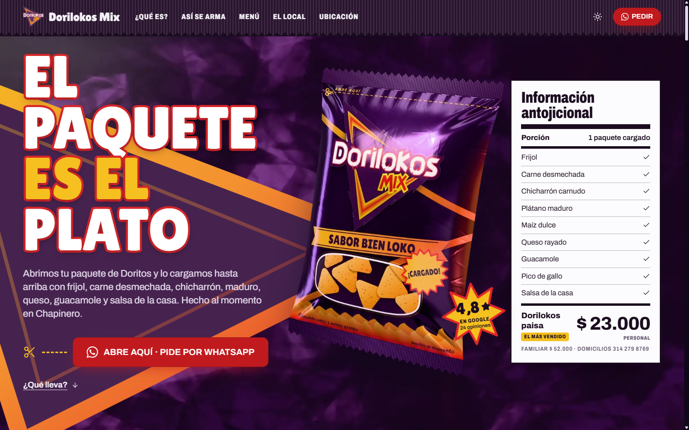
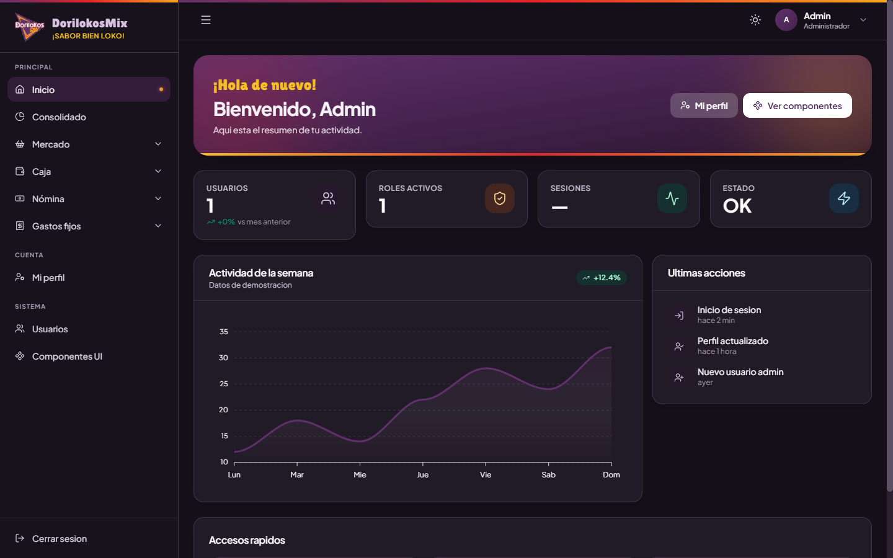
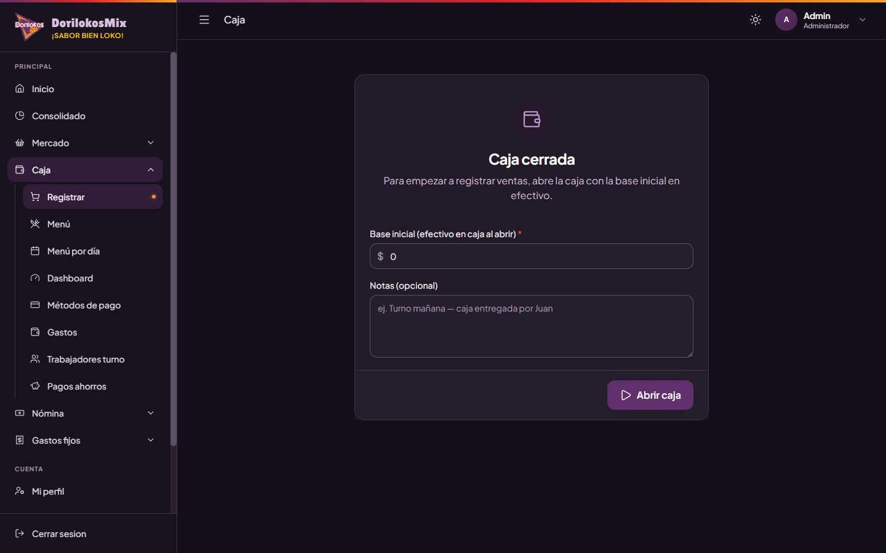
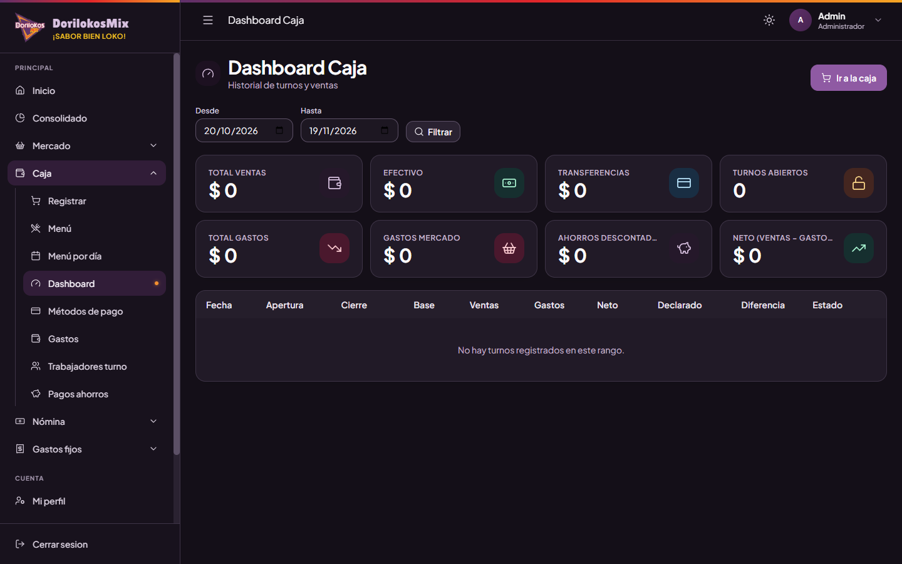
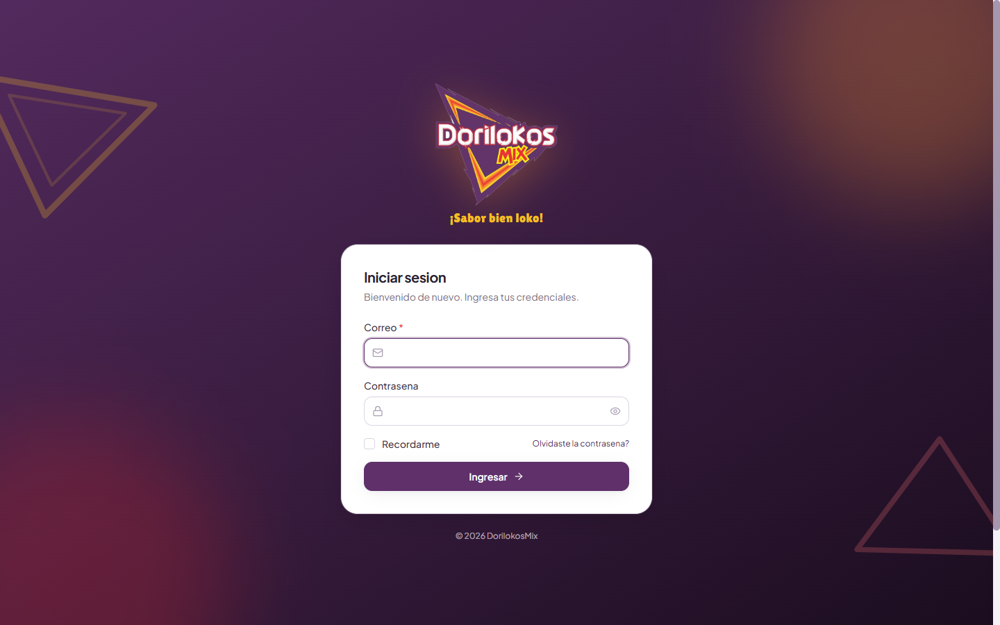

# Dorilokos Mix — POS y gestión integral de restaurante

Sistema de caja, inventario, compras, nómina y finanzas para un restaurante de comida rápida en Bogotá, con landing pública incluida.



## Contexto

Un negocio de comida pequeño que llevaba caja, compras de mercado y pagos a trabajadores en cuadernos. El objetivo fue un solo sistema, fácil de usar en una tablet en el mostrador, que mostrara cuánto se vende, cuánto se gasta y cuánto queda.

## Funcionalidades

- **Caja (POS):** apertura con base, registro de ventas por categorías, combos y adiciones, varios métodos de pago y cierre de turno con cuadre (declarado vs. calculado).
- **Menú configurable:** platos, combos con componentes/opciones y **menú por día de la semana**.
- **Mercado e inventario:** registro de compras de insumos, inventario vinculado a la caja (descuenta al vender) y protección contra stock negativo en ventas concurrentes.
- **Nómina:** empleados, liquidación, pagos masivos, prestaciones sociales y **ahorros de trabajadores**.
- **Gastos y gastos fijos mensuales** con un **consolidado general** de ingresos y egresos por método de pago.
- **Roles:** administrador y rol *ventas* (solo caja).
- **API REST de solo lectura** (Sanctum) consumida por la app móvil *Mis Negocios*.
- **Landing pública** animada (GSAP, Lenis) con menú y pedidos por WhatsApp.

## Stack

- **Backend:** PHP 8, Laravel 9, MySQL/MariaDB
- **Autenticación y permisos:** Laravel Breeze + spatie/laravel-permission (roles y permisos)
- **Frontend:** Blade, Alpine.js, Tailwind CSS, Preline UI, ApexCharts, Tom Select, Lucide icons, GSAP, Lenis
- **API:** Laravel Sanctum

## Capturas

**Dashboard**



**Caja: apertura de turno**



**Dashboard de caja: turnos, ventas y gastos**



**Inicio de sesión**



## Arquitectura

Este sistema forma parte de una familia de aplicaciones para restaurantes que comparten el mismo núcleo (caja, menú, mercado, inventario, nómina y finanzas) y se despliegan por separado para cada negocio, cada uno con su identidad visual y ajustes propios. La lógica de negocio vive en servicios (`app/Services`), los controladores se mantienen delgados y los assets se compilan con Vite para desplegar en hosting compartido sin Node en el servidor.

## Instalación local

Requisitos: PHP 8.0+ (con extensiones `gd`, `zip`, `intl`), Composer, Node 18+ y MySQL/MariaDB.

```bash
git clone <url-del-repositorio>
cd dorilokos
composer install
npm install && npm run build
cp .env.example .env        # configura la conexión a la base de datos
php artisan key:generate
php artisan migrate --seed
php artisan serve
```

La aplicación queda disponible en `http://localhost:8000`. Los seeders crean los roles y datos iniciales (revisa `database/seeders`).

## Notas

- Proyecto desarrollado para un cliente real y desplegado en producción. Las capturas se tomaron en un entorno local; el historial de este repositorio se depuró para no incluir credenciales ni copias de bases de datos.

## Autor

**Santiago Bellaizán** — Desarrollador Full Stack (Laravel · PHP · MySQL · JavaScript)

- GitHub: [@Santibc](https://github.com/Santibc)
